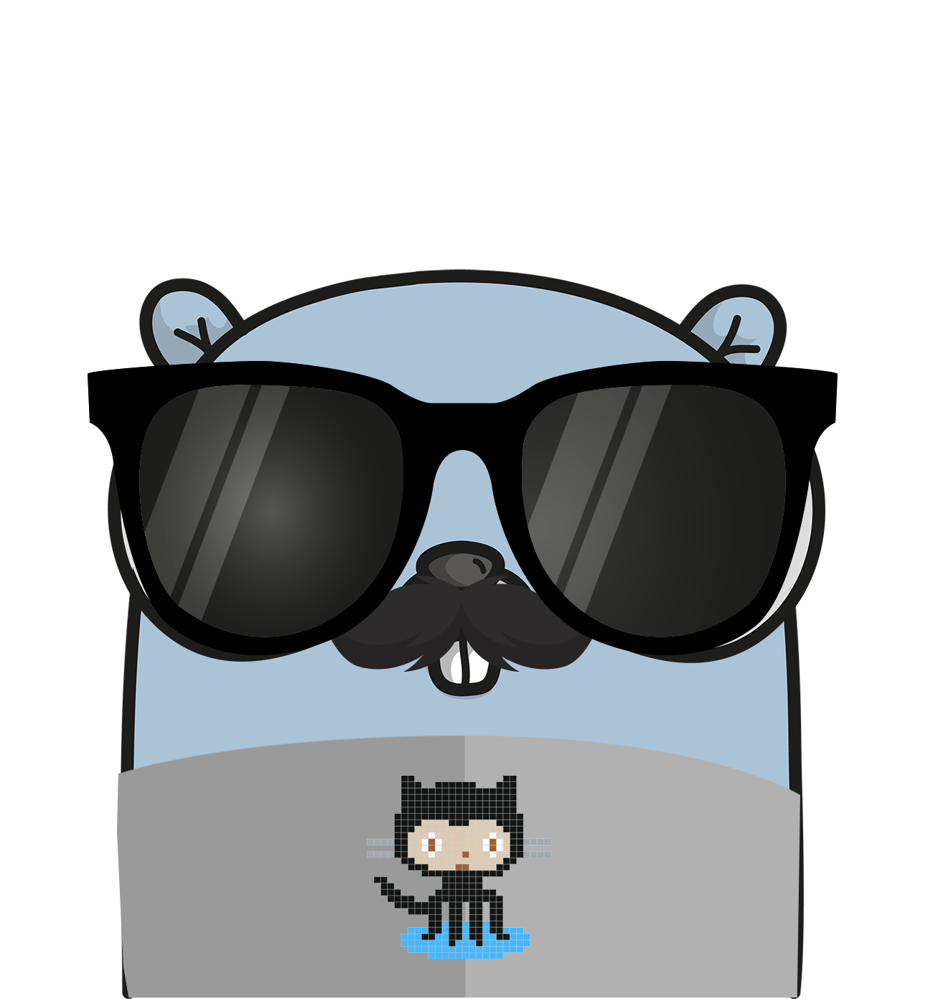
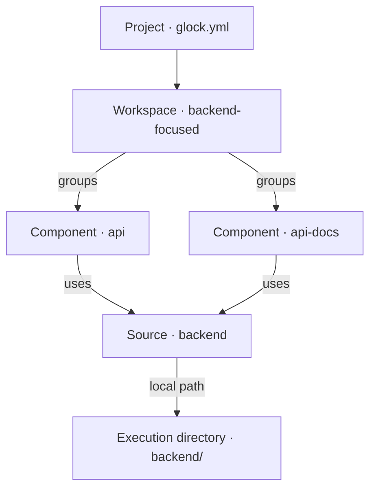

# Glock - Simplify Multi-Repository Project Management

> Shooting flies with a bazooka

<p align="center">
   
</p>
<p align="center">
    <a href="https://github.com/AzraelSec/Glock/releases"></a>
    <!-- <a href="https://pkg.go.dev/github.com/AzraelSec/Glock?tab=doc"></a> -->
    <a href="https://github.com/AzraelSec/Glock/actions"></a>
    <a href="https://coveralls.io/github/AzraelSec/Glock?branch=main"></a>
</p>

## Introduction

Welcome to Glock, the ultimate tool for managing your multi-repository projects with ease! Are you tired of juggling multiple repositories, versioning issues, and complex stacks? Look no further! Glock is here to simplify your development process and make it as effortless as shooting flies with a bazooka!

Glock is a powerful open-source project developed in Go, designed to assist teams in managing the development of their multi-repository projects. It offers a range of handy commands that streamline versioning, stack execution, and other useful operations. With Glock, you can bid farewell to those tedious manual tasks and embrace a smoother, more efficient workflow.

> [!WARNING]
> Please keep in mind that Glock is still under active development
> and therefore backward compatibility is not guaranteed and breaking changes are expected.

See [glock.example.yml](glock.example.yml) for an annotated configuration example.

## Key Features

- **Effortless Versioning:** Glock makes version management a breeze, allowing you to easily handle multiple repositories and their associated versions. Say goodbye to versioning conflicts and hello to seamless collaboration.

- **Streamlined Stack Execution:** With Glock, running your stack becomes a walk in the park, even if you're dealing with heterogeneous stacks. Its intuitive commands ensure that your projects operate smoothly and consistently across different environments.

- **All-in-One Solution:** Glock serves as your go-to tool, eliminating the need for countless small scripts to perform various development tasks. Say goodbye to fragmented workflows and welcome a unified solution for managing your multi-repository projects.

- **Open Source:** Glock is an open-source project, which means it's not only free to use but also encourages community contribution. You can enhance Glock's functionality, fix issues, or customize it to suit your unique requirements.

## Getting Started

To get started with Glock, follow these simple steps:

1. Clone the Glock repository to your local machine using the following command:

   ```bash
   git clone https://github.com/AzraelSec/glock.git
   ```

2. Change to the project directory:

   ```bash
   cd glock
   ```

3. Before using Glock, make sure you have Go installed on your system. You can download and install Go from the [official Go website](https://golang.org/dl/).

4. Build Glock by running the following command:

   ```bash
   make build
   ```

   This will compile the Glock binary.

## Configuration

A **project** is the set of sources, components, workspaces, and tasks defined
in one `glock.yml`. Glock uses the file named by `GLOCK_CONFIG_PATH` when set.
Otherwise it looks for the nearest `glock.yml` in the current directory or up
to 20 parent directories. The directory containing the file is the **project
root**. Relative source paths are resolved from there.

### How the pieces fit

A **source** provides files. A **component** defines a command to run, and a
**process** is one running instance of that command. A **workspace** groups
components. A **task** defines a one-shot command that a **lifecycle hook** runs
during setup or cleanup.

In the [example configuration](glock.example.yml), the `api` and `api-docs`
components share one Git checkout.



### `sources`

Each key in `sources` names a location that provides files. For example,
`backend` names a Git checkout at `backend/` and `tools` points to an existing
directory at `/opt/acme/tools`. Each source requires a `type` and a local `path`.

| `type` | Source configuration |
| --- | --- |
| `github` | Required `url` for the Git repository and `head` for its configured branch or tag. Optional `updater` and `exclude_tag`. |
| `http`, `s3` | Required `url` for the remote content. Populate the local directory before running a component that uses it. |
| `filesystem` | `path` points to an existing directory. Use an absolute path or a path relative to the project root. |

Remote source paths must be relative and contain no `..` segments. A Git
source's `path` must name a subdirectory of the project root. Symlinks may
resolve outside the project root.

For Git sources, `updater` selects `yarn`, `npm`, `pnpm`, `bundler`, `go mod`, or
`cargo`. Omit it to infer the updater from dependency files, or set it to
`_ignore_` to skip dependency updates. Set `exclude_tag: true` to leave that
source out of tagging and tag previews.

### `components`

Each key in `components` names a runnable unit, such as `api`, `SPA`, or
`local-proxy`. Its **execution directory** is the working directory for both
the main process and its lifecycle tasks.

| Field | Meaning |
| --- | --- |
| `run` | Required shell command. For example, `SPA` runs `pnpm run dev`. |
| `source` | Optional key from `sources`. `SPA` uses `frontend`, so its execution directory is `frontend/`. A component without a source, such as `local-proxy`, runs in the project root. |
| `env_filenames` | Optional list of dotenv files relative to the execution directory. In the example, `api` loads `.env` then `.env.local`, so values from `.env.local` win. Environment variables set in the launching shell take precedence over both files. |
| `on` | Optional lifecycle hooks for this component. |

### `workspaces`

Each workspace maps a name to a list of component keys. For example,
`backend-focused` groups `api` and `api-docs` for runtime operations. Use
lifecycle hooks for setup that must finish before a component starts.

### `tasks` and `on`

Declare each reusable task under the top-level `tasks` map. A task requires a
`run` command and accepts an optional `description`. In the example,
`build-assets` runs `pnpm run build`.

An `on` block refers to tasks by key. Place it at the top level to run hooks
from the project root around the whole stack, or under a component to run
hooks in that component's execution directory. Choose one form per block.

- `startup` and `shutdown` are separate lists of task keys. Glock awaits startup
  tasks in order and stops starting tasks on the first failure. It also attempts
  the shutdown tasks after startup fails.
- `steps` is a list of entries with a required `startup` task and an optional
  `cleanup` task. Glock registers each cleanup after its startup task succeeds
  and runs registered cleanups once in reverse order. A failed startup task is
  responsible for cleaning up its own partial work.

For example, `SPA` builds its assets before starting and registers
`clean-assets` after the build succeeds.

```yaml
components:
  SPA:
    source: frontend
    run: pnpm run dev
    on:
      steps:
        - startup: build-assets
          cleanup: clean-assets
```

### `tag_pattern`

This top-level Go template sets the tag name for Git sources and is required
for tagging. `.Now` is shared across repositories for the invocation, and
`.Branch` contains the selected ref for each repository. For example,
`'v{{ .Now.Format "20060102.150405" }}'` produces a timestamped tag.

### Upgrade an existing configuration

Back up your `glock.yml` before upgrading. For an older config with a top-level
`repos` section, move the repository definitions into `sources` and define the
commands you want to run under `components`. Use the
[configuration example](glock.example.yml) to check paths and lifecycle hooks.

If you adopted an earlier draft of this schema, remove the top-level `version`
field and rename source directory fields from `out` to `path`. The built-in
migration command has been removed. Validate the rewritten config before
starting the project. See [GitHub Releases](https://github.com/AzraelSec/Glock/releases)
for changes in each release.

## Commands

The examples use `glock` on your PATH. From the Glock checkout after
`make build`, use `./glock` with the same arguments. Run `glock --help` for
the command list or `glock <command> --help` for a command's flags.

### Validate and run a stack

```sh
glock config validate
glock start
glock start --repos backend
```

`glock config validate` checks field values and references without starting
processes. `glock start` starts all components, including sourceless ones.
`--repos` filters by Git source key. In the example, `--repos backend` selects
`api` and `api-docs`.

Glock labels output by component, cleans up failed components, and keeps healthy
ones running. When `start` ends, it exits nonzero if any component failed. If
output falls behind or a pipe cannot be fully drained, Glock reports the loss
on shutdown.

### Initialize repositories

- `glock init local` clones the Git sources from the resolved config.
- `glock init remote <url> [dir]` downloads the config into the target directory
  before cloning. After a partial failure, fix the reported error and run
  `glock init local` from that directory, or point `GLOCK_CONFIG_PATH` at the
  downloaded file. Glock verifies the checkout root, origin URL, checked-out
  commit, and readable Git index before skipping an existing checkout.

### Work with Git sources

These commands operate on the Git sources defined in `glock.yml`.

- `glock status` groups repositories by working-tree and upstream status.
- `glock switch` opens a searchable branch picker and lets you review which
  repositories are eligible before switching. `glock switch <branch>` switches
  directly.
- `glock reset` returns repositories to their configured refs. If a branch and
  tag share a name, the local branch takes precedence. A tag checkout uses
  detached HEAD and skips pulling. Use `--exclude frontend` to omit a source by
  key. Repeat `--exclude` or pass comma-separated keys to omit several. A dirty
  selected repository blocks reset by default. Add `--skip-dirty` to leave
  those repositories alone and continue with clean ones.
- `glock tag --preview` shows the planned tag, source ref, and destination.
  Combine it with `--skip-push`, `--current`, or `--pre-pull=false` to preview
  the options you intend to use.
- `glock update` shows update progress. Use ↑/↓ to select a failure and Enter
  to expand it. Press `q` or Esc to close the results once updates finish.

## License

Glock is released under the [MIT License](LICENSE). You are free to use, modify, and distribute this software in compliance with the terms of the license.
