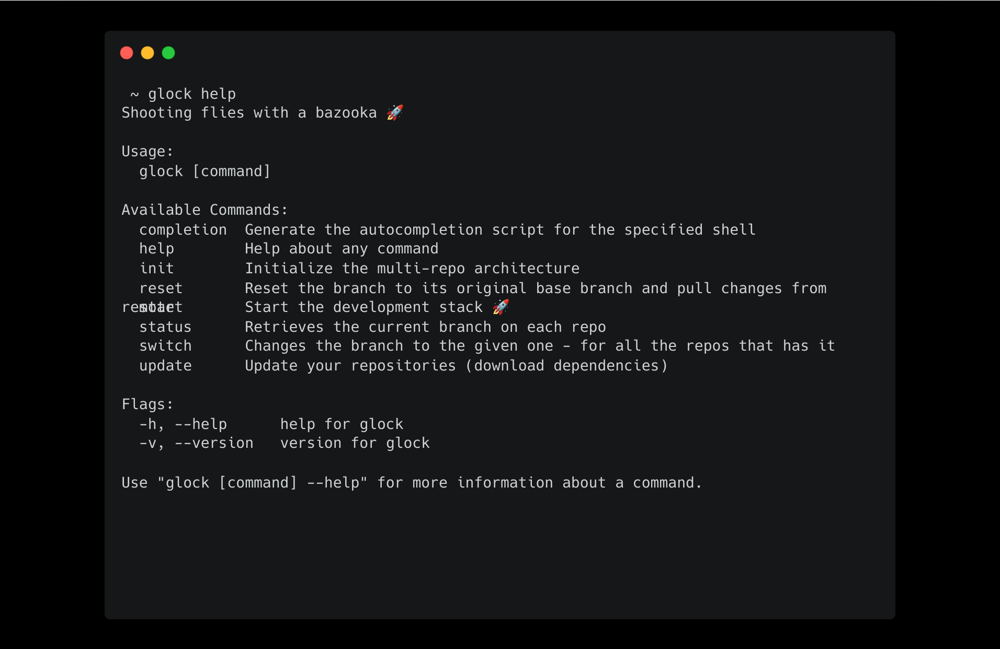

# Glock - Simplify Multi-Repository Project Management

> Shooting flies with a bazooka

<p align="center">
   
</p>
<p align="center">
    <a href="https://github.com/AzraelSec/Glock/releases"></a>
    <!-- <a href="https://pkg.go.dev/github.com/AzraelSec/Glock?tab=doc"></a> -->
    <a href="https://github.com/AzraelSec/Glock/actions"></a>
    <a href="https://coveralls.io/github/AzraelSec/Glock?branch=main"></a>
</p>

## Introduction

Welcome to Glock, the ultimate tool for managing your multi-repository projects with ease! Are you tired of juggling multiple repositories, versioning issues, and complex stacks? Look no further! Glock is here to simplify your development process and make it as effortless as shooting flies with a bazooka!

Glock is a powerful open-source project developed in Go, designed to assist teams in managing the development of their multi-repository projects. It offers a range of handy commands that streamline versioning, stack execution, and other useful operations. With Glock, you can bid farewell to those tedious manual tasks and embrace a smoother, more efficient workflow.

> [!WARNING]
> Please keep in mind that Glock is still under active development
> and therefore backward compatibility is not guaranteed and breaking changes are expected.

See [glock.example.yml](glock.example.yml) for configuration and
[architecture.md](architecture.md) for runtime behavior.

## Key Features

- **Effortless Versioning:** Glock makes version management a breeze, allowing you to easily handle multiple repositories and their associated versions. Say goodbye to versioning conflicts and hello to seamless collaboration.

- **Streamlined Stack Execution:** With Glock, running your stack becomes a walk in the park, even if you're dealing with heterogeneous stacks. Its intuitive commands ensure that your projects operate smoothly and consistently across different environments.

- **All-in-One Solution:** Glock serves as your go-to tool, eliminating the need for countless small scripts to perform various development tasks. Say goodbye to fragmented workflows and welcome a unified solution for managing your multi-repository projects.

- **Open Source:** Glock is an open-source project, which means it's not only free to use but also encourages community contribution. You can enhance Glock's functionality, fix issues, or customize it to suit your unique requirements.

## Getting Started

To get started with Glock, follow these simple steps:

1. Clone the Glock repository to your local machine using the following command:

   ```bash
   git clone https://github.com/AzraelSec/glock.git
   ```

2. Change to the project directory:

   ```bash
   cd glock
   ```

3. Before using Glock, make sure you have Go installed on your system. You can download and install Go from the [official Go website](https://golang.org/dl/).

4. Build Glock by running the following command:

   ```bash
   make build
   ```

   This will compile the Glock binary.

5. Once the build is complete, you can start using Glock by running the generated executable file:

   ```bash
   ./glock
   ```

   This will display a list of available commands and provide you with everything you need to manage your multi-repository projects effectively.

<p align="center">
   
</p>

## Configuration

Project commands validate `glock.yml` against the current schema. See the
[release notes](RELEASE_NOTES.md) for upgrade instructions. Config discovery uses
`GLOCK_CONFIG_PATH` or the nearest parent `glock.yml` (up to 20 levels).
The directory containing the file is the project root. Git sources use `url`,
`head`, and a required `path`. Remote source paths are relative to the project
root and cannot contain `..`; a Git path cannot be the project root. This is a
lexical rule: symlinks can point outside the project, and paths are not a
security boundary.
Filesystem source paths identify existing directories directly and can be
absolute or relative to the project root. Components and their hooks run there.
`status`, `switch`, `reset`, `init`, `update`, and `tag` operate once per Git
source, ignoring non-Git sources. Acquisition for other source types is not
implemented by `init`.
For a Git source pinned to a tag, `reset` checks out that tag in detached HEAD
and skips the pull. A local branch takes precedence if it has the same name.

```sh
glock config validate
glock start
glock start --repos backend
```

`start` keeps tagged terminal output and now runs the engine lifecycle: startup
hooks are awaited, workspaces/components are not readiness dependency graphs,
and shutdown awaits cleanup. There is no fixed five-second service delay.
Glock reports and cleans up failed components while healthy ones keep running.
When `start` ends, it exits nonzero if any component failed. Output uses bounded queues: slow consumers can lose
fragments, and Glock reports loss or a truncated pipe drain on shutdown. Retained
snapshot history is bounded independently and exposes its eviction count.

Existing `on.startup` and `on.shutdown` lists retain their original behavior,
including running the shutdown list after a startup failure. For paired
cleanup, use `on.steps` instead (the two forms cannot be mixed in one block):

```yaml
on:
  steps:
    - startup: start-database
      cleanup: stop-database
    - startup: start-mail
      cleanup: stop-mail
```

Each successful step registers its cleanup; registered cleanups run once in
reverse order. A failed step must clean up its own partial effects. Steps use
task keys and are supported at application and component scope.

Shell environment values override dotenv files. `--repos` selects components
referencing the named Git sources; without a filter, sourceless services run too.
After a failed `init remote`, the downloaded config and successful clones are
retained. Fix the error and run `glock init local` in the config directory (or
set `GLOCK_CONFIG_PATH` to that config). Existing checkouts are skipped only
when their root, origin URL, checked-out commit, and readable Git index are
verified; other existing destinations are reported without modification. A
missing index may indicate an incomplete checkout and requires manual review.

Git sources support `updater` and `exclude_tag`; `tag_pattern` remains top-level.
The existing update, status, switch, and tag interfaces remain available.

## License

Glock is released under the [MIT License](LICENSE). You are free to use, modify, and distribute this software in compliance with the terms of the license.
